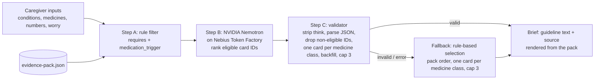
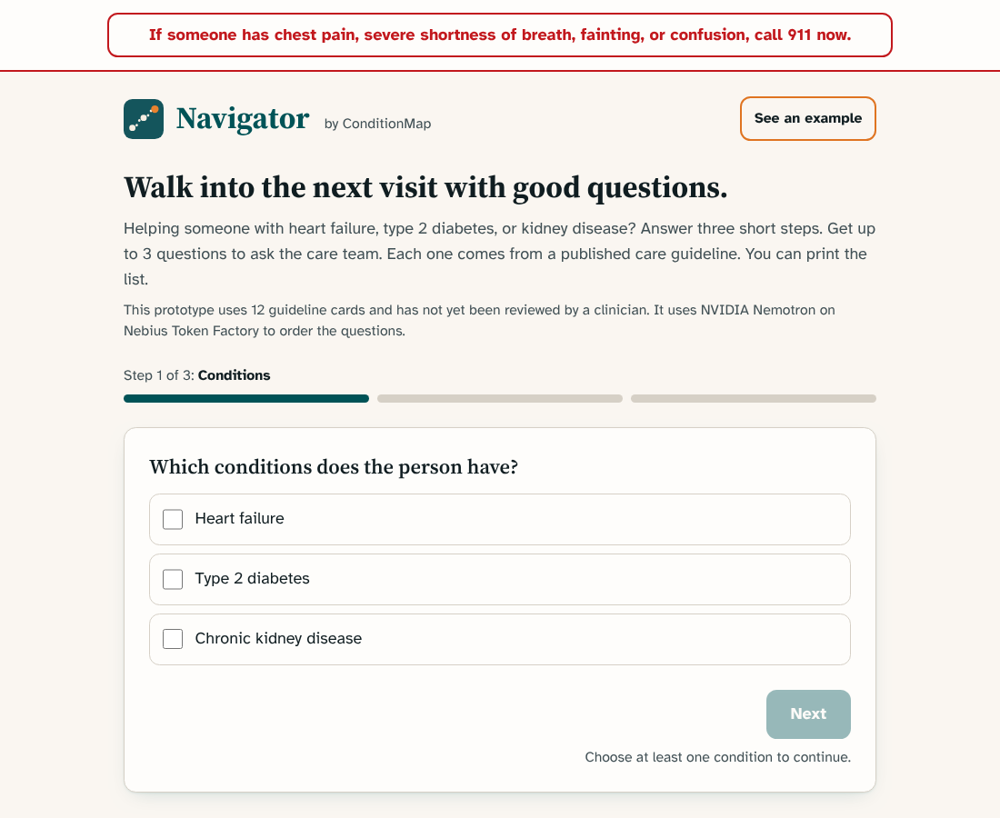
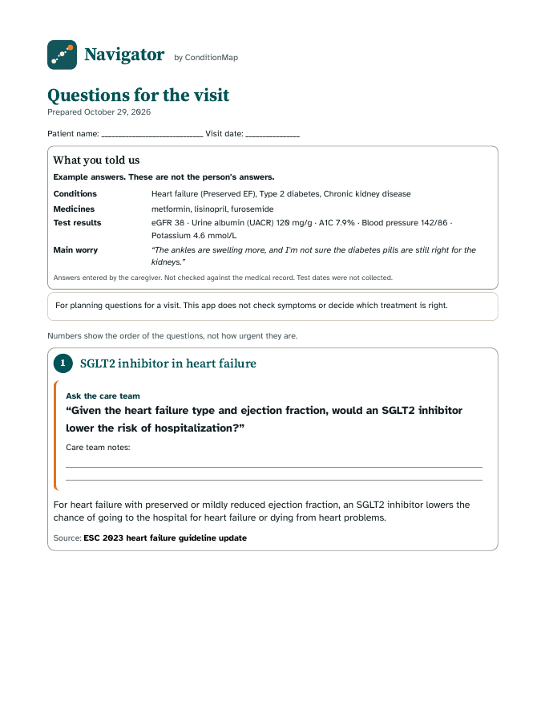
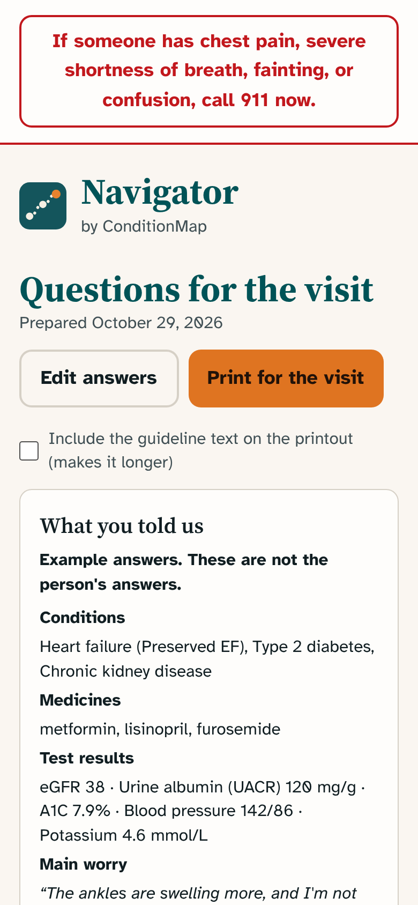

# Navigator by ConditionMap

A caregiver appointment-brief tool for people living with heart failure, type 2 diabetes, and chronic kidney disease (any combination; kidney disease alone gets no questions). Caregivers answer three short steps and get up to 3 questions, each with a question to ask the clinician, the guideline text, and a DOI-linked source.

**Live demo:** https://navigateconditionmap.lovable.app

**Try it:** no login needed, and this app does not store what you enter. Pick conditions, add medicines and recent numbers if you have them, and get a brief.

**Educational only. Not medical advice.** Submission for the Nebius x NVIDIA Global AI Hackathon (Best Apps and Agents track).

## Evidence-first pipeline



The model never supplies text you read. It only orders card IDs. Guideline text, questions, sources, and labels are always rendered from the evidence pack.

Class dedupe and backfill (`src/lib/navigator.ts`, shared by the model path and the fallback): the brief keeps at most one card per medicine class, SGLT2 inhibitors (E2, E3, E9, E11, E12) and nonsteroidal MRAs (E6, E10). Other cards in the same class are listed as supporting cards. If the model ranks fewer than 3 usable topics, the remaining slots are filled from eligible cards in pack order, using the card's own guideline text. The fallback runs the same selection on eligible cards in pack order (for heart failure, E9 or E3 first depending on ejection fraction type), so it never needs the model.

## How Nemotron and Nebius Token Factory are used

- Server endpoint: `src/routes/api/public/navigator-brief.ts` (`POST /api/public/navigator-brief`), running server-side on Lovable Cloud hosting. The evidence pack is embedded at `src/server/evidence-pack.ts` (a test checks it matches `src/data/evidence-pack.json`).
- Base URL `https://api.tokenfactory.nebius.com/v1`, OpenAI-compatible `POST /chat/completions`, `temperature 0`, `max_tokens 600`, 20 s timeout.
- JSON mode: requests set `response_format: {"type": "json_object"}`, and the prompt requires one object of the form `{"points":[{"card_id":"E2"},{"card_id":"E4"}]}`, an ordering only. Any sentence the model adds is ignored. The validator still strips code fences and `<think>` blocks before parsing, and rejects anything that does not parse.
- Thinking off: for Nemotron models the request sends `chat_template_kwargs: {"enable_thinking": false}`, so the token budget goes to the JSON brief instead of reasoning text.
- Model selection: `NEBIUS_MODEL` if set; otherwise `GET /v1/models`, keep ids containing "nemotron", prefer "super", then "nano", then the first. Cached in memory. The model id and latency are returned and shown in the UI.
- Health check: `POST {"health": true}` returns the selected model and the list of Nemotron model ids (never the key).

## Setup

Prerequisites: [Bun](https://bun.sh) (tested with 1.4.4) and Node 22 or newer (tested with 22.22). The lockfile is `bun.lock`. No other tools or environment variables are needed.

```bash
bun install --frozen-lockfile
bunx vitest run    # tests: pipeline, wording checks, request guards
bun run build      # production build
bun run dev        # local dev server
```

Without a key the app runs end to end using the rule-based fallback and shows a notice that the AI service is unavailable.

For live Nemotron answers:

1. Create an API key in the Nebius Token Factory console (https://tokenfactory.nebius.com, API keys).
2. `cp .env.example .env` and set `NEBIUS_API_KEY=...` (optional `NEBIUS_MODEL=`). `.env` is git-ignored. Never commit a key.
3. Restart `bun run dev`. The model id and response time then appear under "How this page was made" on the results page.

On the hosted version the key is set as a secret in the Lovable project settings.

## Repository map

| Path                                       | What it is                                                                                                     |
| ------------------------------------------ | -------------------------------------------------------------------------------------------------------------- |
| `src/data/evidence-pack.json`              | The 12 guideline cards and their sources (source of truth for all medical text)                                |
| `src/server/evidence-pack.ts`              | Server copy of the same pack (a test checks the two are identical)                                             |
| `src/lib/navigator.ts`                     | Card filter, model-output validator, wording checks, fallback                                                  |
| `src/routes/api/public/navigator-brief.ts` | The server route that calls Nebius Token Factory (key read at line 97, `/chat/completions` call from line 148) |
| `src/server/request-guards.ts`             | Body size cap and per-IP rate limit                                                                            |
| `src/routes/index.tsx`                     | The three-step form, results page, and print layout                                                            |
| `scripts/eval`                             | 30 synthetic cases, the live runner, and the scorer                                                            |
| `docs/screenshots`                         | Screenshots of the app with synthetic example answers                                                          |

## Screenshots

All screenshots use synthetic example answers, not a real person. The results page shows real output from the live model.






## Evaluation

`scripts/eval` runs 30 synthetic caregiver cases (no real patient data) against the live endpoint and scores the responses (`bun scripts/eval/score.ts scripts/eval/after-019bcea.json`). Result files: `baseline.json` (build `814a82d`), `after.json` (`507bb50`), `after-c9d432b.json`, `after-791de5e.json`, and `after-019bcea.json` (current build). All runs were on Oct 29, 2026.

|                                       | `814a82d`                                                | `507bb50`                           | `c9d432b`                          | `791de5e`                                                         | Current (`019bcea`)                 |
| ------------------------------------- | -------------------------------------------------------- | ----------------------------------- | ---------------------------------- | ----------------------------------------------------------------- | ----------------------------------- |
| Answered by Nemotron                  | 27 of 30                                                 | 28 of 30                            | 28 of 30                           | 27 of 30                                                          | 28 of 30                            |
| Fallback                              | 3 (2 kidney-only cases with no cards, 1 Nebius HTTP 529) | 2 (the same kidney-only cases)      | 2 (the same kidney-only cases)     | 3 (2 kidney-only cases, 1 unusable model output; 0 of 6 on retry) | 2 (the kidney-only cases)           |
| Model response time (server-measured) | median 1.9 s, p90 5.4 s, max 12.2 s                      | median 1.7 s, p90 5.1 s, max 13.8 s | median 1.5 s, p90 1.9 s, max 2.1 s | median 0.9 s, p90 1.6 s, max 1.9 s                                | median 0.9 s, p90 1.6 s, max 10.1 s |
| Model-written sentences shown         | 64 of 67 (96%)                                           | 52 of 67 (78%)                      | 12 of 67 (18%)                     | 0 (not shown by design)                                           | 0 (not shown by design)             |
| Violations of 6 structural rules\*    | 0                                                        | 0                                   | 0                                  | 0                                                                 | 0                                   |
| Heart failure cards that did not fit  | see note                                                 | see note                            | 0                                  | 0                                                                 | 0                                   |

\*At most 3 points, at most one card per medicine class, only eligible cards, questions verbatim from the card, no milligram dose, no relationship words.

How the design changed: each stricter wording check replaced more of the model's sentences with the guideline's own wording (4%, 22%, then 82% replaced). An adversarial test of 171 unsafe sentences passed 159 through the earlier checker and 15 through the allowlist (13 were cards' own wording). A later audit then reproduced a reversal on the live site: a crafted concern field made the model write "Combining an ACE inhibitor with an ARB is advised for people with diabetes", which used only words from the card and passed the allowlist. A word check cannot catch negation or a swapped subject. From build `791de5e` on, the model orders cards and writes no text that is shown, and the same attack returns the card's own wording. The adversarial test script is not included in this repository. The scores cover structure and listed wording rules only. They do not establish clinical correctness, and thirty synthetic cases from one day is a small sample. The older runs sent test results to the endpoint; the server now ignores them.

### Does Nemotron's ranking beat the rule-based fallback?

`scripts/eval/ranking.ts` fixes eight situations and, for seven of them, a concern with a predefined expected card (chosen by the author before running). It then checks whether that card is in the top 3. Result on build `c7a075f` (`scripts/eval/ranking.json`): Nemotron 7 of 7, rule fallback 3 of 7. Nemotron's ranking changes which cards appear in response to the concern; the fallback cannot. This is seven author-chosen cases, not a general measure of ranking quality, and it does not measure clinical usefulness. The model also returns a yes or no "matches the concern" flag per card, shown only as a fixed label. `scripts/eval/stability.ts` repeats four of those concerns five times each: the expected card was in the top 3 in 20 of 20 calls, and the full top 3 was identical across repeats in 18 of 20 (the variation was in the second and third slots; one call right after a deployment returned a different list). That flag is the model's judgment and is not measured: in one case it also marked the metformin card for a heart failure concern.

### Running the evaluation yourself

```bash
bun scripts/eval/run.ts https://navigateconditionmap.lovable.app scripts/eval/mine.json
bun scripts/eval/score.ts scripts/eval/mine.json
```

The runner sends 30 live requests paced 62 seconds apart by default (about 31 minutes; `EVAL_PACE_MS` changes the pace). The endpoint limits each IP address, so do not run other traffic from the same address meanwhile.

## Known limitations

- Every kidney card requires type 2 diabetes, so kidney disease on its own returns no cards, and kidney disease with heart failure shows heart failure cards only. The app says so on screen.
- Twelve cards from five guideline documents. This is not a complete clinical guideline set, and the cards have not had a clinician review.
- The rate limit and the model-list cache live in one server instance's memory, so the limits are approximate.

## Project history and what changed during the hackathon

The hackathon submission period began on August 26, 2026. This repository was created on October 28, 2026, and every commit in it is dated October 28 or 29, 2026. An earlier prototype (a Netlify and Tavily version) is in `saebchicago/conditionmap-navigator`, also from October 28. The history here is:

| Date   | Commit    | Change                                                                                                             |
| ------ | --------- | ------------------------------------------------------------------------------------------------------------------ |
| Oct 28 | `2ed2f96` | v1.0: evidence-pack pipeline, Nemotron ranking, validator, fallback                                                |
| Oct 28 | `814a82d` | Evidence wording fixes, request guards, README accuracy                                                            |
| Oct 29 | `693a655` | Interface pass: personal results summary, print fixes, new identity                                                |
| Oct 29 | `4be4b12` | Stricter claim checks, steadier output, evaluation scripts                                                         |
| Oct 29 | `f85f9d8` | Baseline evaluation results                                                                                        |
| Oct 29 | `18d217d` | Explain the kidney-only gap on screen                                                                              |
| Oct 29 | `6cfd533` | Privacy copy revised, advice-word checks, input whitelist, print fix                                               |
| Oct 29 | `507bb50` | Visit-day layout pass: hidden ranking commentary, kidney-only notice, compact print brief                          |
| Oct 29 | `973eeac` | Post-publish evaluation results                                                                                    |
| Oct 29 | `ac18309` | README, setup, CI, screenshots                                                                                     |
| Oct 29 | `c9d432b` | Allowlist wording check, test results no longer sent to the model, audit fixes                                     |
| Oct 29 | `6e3d772` | Evaluation results for the allowlist build                                                                         |
| Oct 29 | `019bcea` | Current-medicine parsing, full card text, urgent-symptom notice, concern-match label, E12 grouped with SGLT2 cards |
| Oct 29 | `791de5e` | Model only orders cards; its sentences are never shown (fixes a reversal found in audit)                           |

Parts of the code were written with AI coding assistants (Claude Code and Lovable). The author made the product, content, and safety decisions and reviewed the changes.

## Feedback on Nebius Token Factory and NVIDIA Nemotron

What worked, from building and running this app:

- The OpenAI-compatible API worked with a plain `fetch` call and no SDK.
- JSON mode (`response_format`) returned parseable objects in the evaluation runs, and `chat_template_kwargs.enable_thinking: false` kept replies fast: median 0.9 s and 90th percentile 1.6 s over 27 answered cases in the current build (1.7 s and 5.1 s in build 507bb50).
- `GET /v1/models` made it possible to pick a Nemotron model at runtime instead of hard-coding one.

What would help:

- Model ids use mixed naming (for example `nvidia/nemotron-3-super-120b-a12b` next to `nvidia/Nemotron-3_5-Lightning` and `nvidia/NVIDIA-Nemotron-3-Nano-30B-A3B`), which makes pattern-based selection brittle. Stable aliases would help.
- Clearer documentation of which Nemotron models support JSON mode and the thinking switch.
- One request in the first 90 evaluation calls returned HTTP 529 (overloaded). Published guidance on retry behavior and expected capacity would help.

## Evidence sources

- ADA/KDIGO 2022. Diabetes Management in CKD: A Consensus Report. de Boer IH, et al. doi:[10.2337/dci22-0027](https://doi.org/10.2337/dci22-0027)
- ESC 2023 Focused Update of the 2021 HF Guidelines. McDonagh TA, Metra M, et al. doi:[10.1002/ejhf.3024](https://doi.org/10.1002/ejhf.3024)
- AHA/ACC/HFSA 2022 HF Guideline. Heidenreich PA, Bozkurt B, et al. doi:[10.1161/CIR.0000000000001063](https://doi.org/10.1161/CIR.0000000000001063)
- ADA Standards of Care in Diabetes 2026, Section 10: Cardiovascular Disease and Risk Management. ADA Professional Practice Committee. doi:[10.2337/dc26-S010](https://doi.org/10.2337/dc26-S010)
- ADA Standards of Care in Diabetes 2026, Section 11: Chronic Kidney Disease and Risk Management. ADA Professional Practice Committee. doi:[10.2337/dc26-S011](https://doi.org/10.2337/dc26-S011)

### Evidence cards

| Card | Topic                                                              | Shown when                              | Source                     |
| ---- | ------------------------------------------------------------------ | --------------------------------------- | -------------------------- |
| E1   | Kidney screening                                                   | Type 2 diabetes                         | ADA/KDIGO 2022             |
| E2   | SGLT2 inhibitor for kidney protection                              | Type 2 diabetes + CKD                   | ADA/KDIGO 2022             |
| E3   | SGLT2 inhibitor in heart failure                                   | Heart failure                           | ESC 2023                   |
| E4   | Metformin and kidney function                                      | Type 2 diabetes + CKD, taking metformin | ADA/KDIGO 2022             |
| E5   | ACE inhibitor or ARB with albuminuria                              | Type 2 diabetes + CKD                   | ADA/KDIGO 2022             |
| E6   | Finerenone                                                         | Type 2 diabetes + CKD                   | ADA/KDIGO 2022             |
| E7   | GLP-1 receptor agonist                                             | Type 2 diabetes + CKD                   | ADA Standards 2026, Sec 11 |
| E8   | Blood pressure target                                              | Type 2 diabetes                         | ADA Standards 2026, Sec 10 |
| E9   | SGLT2 inhibitor in reduced ejection fraction                       | Heart failure                           | AHA/ACC/HFSA 2022          |
| E10  | Nonsteroidal MRA in heart failure with ejection fraction above 40% | Heart failure + type 2 diabetes         | ADA Standards 2026, Sec 10 |
| E11  | SGLT2 inhibitor to prevent heart failure                           | Type 2 diabetes + CKD                   | ESC 2023                   |
| E12  | SGLT2 inhibitor and finerenone together                            | Type 2 diabetes + CKD                   | ADA Standards 2026, Sec 11 |

## Safety design

- Always-visible emergency banner (call 911).
- Deterministic eligibility filter around the model. When the heart failure type is known, cards written for a different type are dropped. Brand names that contain metformin trigger the metformin card; entries such as "no metformin" do not.
- The model only chooses the order of the cards and flags which cards match the caregiver's concern (a boolean, shown as a fixed label). Every question, explanation, and source shown is the evidence card's own wording, shown in full so that qualifications (for example, that an ACE inhibitor and an ARB are not advised together) stay beside the statement. A model-drafted sentence can reverse a card using only that card's words, so none is shown.
- The allowlist check (`outsideVocabulary` in `src/lib/navigator.ts`) and the other wording checks remain in the code as a second layer, but the shown text no longer depends on them. Because the model writes nothing that is shown, the concern field can only change the order of real cards.
- Test results are not sent to the model. The model ranks using conditions, medicines, heart failure type, and the caregiver's concern. A card that names an eGFR level or potassium shows a note that asks the caregiver to bring the latest result to the care team; it does not compare the caregiver's number with the card.
- Inputs are limited server-side: conditions to the three known keys, heart failure type to the four UI options, numbers to five known fields, and the endpoint has a body-size cap and a per-IP rate limit (60 requests per 10 minutes).
- A medicine line is treated as current only if nothing in it says otherwise ("stopped", "no", "used to take", "allergic", and similar), and lines are split on commas, semicolons, "and", and "plus". Wrongly dropping a card is the safe direction. Free text can still be misread, so confirm the medicine list with the care team.
- If the concern field mentions symptoms such as chest pain or fainting, the results page shows a call-911 notice. The app does not assess symptoms. If no card matches the written concern, the page says so and points to "Your own questions".
- Fallback to rule-based selection on any error, clearly labeled.
- This app saves nothing you enter, and its own code adds no analytics or cookies. Conditions, medicines, heart failure type, and the caregiver's concern are sent through this app's server to the AI provider (Nebius) each time a brief is made; test results stay in the browser. The hosting platform (Lovable, behind Cloudflare) runs its own visitor analytics, which can include page views and clicks, and sets a bot-protection cookie and an analytics session cookie. Fonts load from Google Fonts. What Nebius and the hosting platform retain has not been verified.

## License

Copyright (C) 2026 Saeb A. Ahsan. Built by Saeb Ahsan.

Licensed under the GNU Affero General Public License v3.0 (AGPL-3.0). See [LICENSE](LICENSE). If you run a modified version as a network service, AGPL-3.0 requires you to offer its users the corresponding source.

Commercial licenses are available for uses that cannot meet AGPL-3.0 terms. Contact via [conditionmap.com](https://conditionmap.com).

## Trademarks

"Navigator" and "ConditionMap" names and logos are not licensed under AGPL-3.0; all rights reserved.
