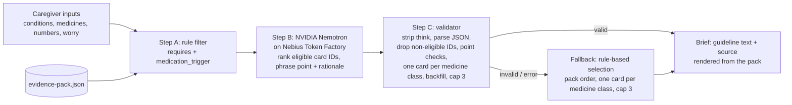

# Navigator by ConditionMap

A caregiver appointment-brief tool for people living with heart failure, type 2 diabetes, and chronic kidney disease (any combination). Caregivers answer three short steps and get up to 3 discussion points, each with a question to ask the clinician, the guideline text, and a DOI-linked source.

**Live demo:** https://navigateconditionmap.lovable.app

**Try it:** no login needed, and this app does not store what you enter. Pick conditions, add medicines and recent numbers if you have them, and get a brief.

**Educational only. Not medical advice.** Submission for the Nebius x NVIDIA Global AI Hackathon (Best Apps and Agents track).

## Evidence-first pipeline



The model never supplies medical content. Guideline text, sources, and labels are always rendered from the evidence pack.

Class dedupe and backfill (`src/lib/navigator.ts`, shared by the model path and the fallback): the brief keeps at most one card per medicine class, SGLT2 inhibitors (E2, E3, E9, E11) and nonsteroidal MRAs (E6, E10). Other cards in the same class are listed as supporting cards. If the model ranks fewer than 3 usable topics, the remaining slots are filled from eligible cards in pack order, using the card's own guideline text. The fallback runs the same selection on eligible cards in pack order (for heart failure, E9 or E3 first depending on ejection fraction type), so it never needs the model.

## How Nemotron and Nebius Token Factory are used

- Server endpoint: `src/routes/api/public/navigator-brief.ts` (`POST /api/public/navigator-brief`), running server-side on Lovable Cloud hosting. The evidence pack is embedded at `src/server/evidence-pack.ts` (a test checks it matches `src/data/evidence-pack.json`).
- Base URL `https://api.tokenfactory.nebius.com/v1`, OpenAI-compatible `POST /chat/completions`, `temperature 0`, `max_tokens 2400`, 20 s timeout.
- JSON mode: requests set `response_format: {"type": "json_object"}`, and the prompt requires one object of the form `{"points":[{"card_id","point","rationale"}]}`. The validator still strips code fences and `<think>` blocks before parsing, and rejects anything that does not parse.
- Thinking off: for Nemotron models the request sends `chat_template_kwargs: {"enable_thinking": false}`, so the token budget goes to the JSON brief instead of reasoning text.
- Model selection: `NEBIUS_MODEL` if set; otherwise `GET /v1/models`, keep ids containing "nemotron", prefer "super", then "nano", then the first. Cached in memory. The model id and latency are returned and shown in the UI.
- Health check: `POST {"health": true}` returns the selected model and the list of Nemotron model ids (never the key).

## Setup

Requires [Bun](https://bun.sh); the lockfile is `bun.lock`.

```bash
bun install --frozen-lockfile
bun run dev        # local dev server
bunx vitest run    # pipeline, point checks, and request guards
bun run build      # production build
```

Add the secret `NEBIUS_API_KEY` in Project Settings → Secrets (optional `NEBIUS_MODEL`). Without a key the app shows the rule-based fallback with a visible notice.

## Known limitations

- Every kidney card requires type 2 diabetes, so kidney disease on its own returns no cards, and kidney disease with heart failure shows heart failure cards only. The app says so on screen.
- Twelve cards from five guideline documents. This is not a complete clinical guideline set, and the cards have not had a clinician review.
- The rate limit and the model-list cache live in one server instance's memory, so they are speed bumps, not hard quotas.

## Evidence sources

- ADA/KDIGO 2022. Diabetes Management in CKD: A Consensus Report. de Boer IH, et al. doi:[10.2337/dci22-0027](https://doi.org/10.2337/dci22-0027)
- ESC 2023 Focused Update of the 2021 HF Guidelines. McDonagh TA, Metra M, et al. doi:[10.1002/ejhf.3024](https://doi.org/10.1002/ejhf.3024)
- AHA/ACC/HFSA 2022 HF Guideline. Heidenreich PA, Bozkurt B, et al. doi:[10.1161/CIR.0000000000001063](https://doi.org/10.1161/CIR.0000000000001063)
- ADA Standards of Care in Diabetes 2026, Section 10: Cardiovascular Disease and Risk Management. ADA Professional Practice Committee. doi:[10.2337/dc26-S010](https://doi.org/10.2337/dc26-S010)
- ADA Standards of Care in Diabetes 2026, Section 11: Chronic Kidney Disease and Risk Management. ADA Professional Practice Committee. doi:[10.2337/dc26-S011](https://doi.org/10.2337/dc26-S011)

### Evidence cards

| Card | Topic | Shown when | Source |
|---|---|---|---|
| E1 | Kidney screening | Type 2 diabetes | ADA/KDIGO 2022 |
| E2 | SGLT2 inhibitor for kidney protection | Type 2 diabetes + CKD | ADA/KDIGO 2022 |
| E3 | SGLT2 inhibitor in heart failure | Heart failure | ESC 2023 |
| E4 | Metformin and kidney function | Type 2 diabetes + CKD, taking metformin | ADA/KDIGO 2022 |
| E5 | ACE inhibitor or ARB with albuminuria | Type 2 diabetes + CKD | ADA/KDIGO 2022 |
| E6 | Finerenone | Type 2 diabetes + CKD | ADA/KDIGO 2022 |
| E7 | GLP-1 receptor agonist | Type 2 diabetes + CKD | ADA Standards 2026, Sec 11 |
| E8 | Blood pressure target | Type 2 diabetes | ADA Standards 2026, Sec 10 |
| E9 | SGLT2 inhibitor in reduced ejection fraction | Heart failure | AHA/ACC/HFSA 2022 |
| E10 | Nonsteroidal MRA in heart failure with ejection fraction above 40% | Heart failure + type 2 diabetes | ADA Standards 2026, Sec 10 |
| E11 | SGLT2 inhibitor to prevent heart failure | Type 2 diabetes + CKD | ESC 2023 |
| E12 | SGLT2 inhibitor and finerenone together | Type 2 diabetes + CKD | ADA Standards 2026, Sec 11 |

## Safety design

- Always-visible emergency banner (call 911).
- Deterministic eligibility filter and validator around the model; model output limited to card IDs and phrasing.
- Prompt forbids new drugs, doses, numbers, or start/stop/change advice; everything is framed as a question.
- Wording checks in code (`src/lib/navigator.ts`), lexical only: a point that adds a number, medicine or brand name, dose word, safety claim, benefit word, advice or certainty word ("stop", "start", "required", "must", "cure"), reassurance ("not urgent"), or a person reference its card does not support is replaced with the card's own wording. The checks do not verify meaning. Rationales get the same checks and are dropped if they fail.
- Heart failure type is limited to the four UI options, numbers to the five known lab fields, and the endpoint has a body-size cap and a per-IP rate limit.
- Fallback to rule-based selection on any error, clearly labeled.
- No login, and this app stores nothing you enter. It adds no analytics or cookies of its own. Inputs live in the browser tab and are sent once to the AI provider (Nebius) to make the page. The hosting platform (Lovable, behind Cloudflare) may load its own script and set a bot-protection cookie, and fonts load from Google Fonts.

## License

Copyright (C) 2026 Saeb A. Ahsan. Built by Saeb Ahsan.

Licensed under the GNU Affero General Public License v3.0 (AGPL-3.0). See [LICENSE](LICENSE). If you run a modified version as a network service, AGPL-3.0 requires you to offer its users the corresponding source.

Commercial licenses are available for uses that cannot meet AGPL-3.0 terms. Contact via [conditionmap.com](https://conditionmap.com).

## Trademarks

"Navigator" and "ConditionMap" names and logos are not licensed under AGPL-3.0; all rights reserved.
