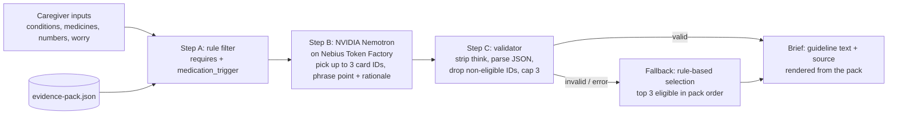

# Navigator by ConditionMap

A caregiver appointment-brief tool for people living with heart failure, type 2 diabetes, and chronic kidney disease (any combination). Caregivers answer three short steps and get up to 3 discussion points, each with a question to ask the clinician, the guideline text, and a DOI-linked source.

**Live demo:** https://navigateconditionmap.lovable.app

**Try it:** no login needed and nothing is stored. Pick conditions, add medicines and recent numbers if you have them, and get a brief.

**Educational only. Not medical advice.** Submission for the Nebius x NVIDIA Global AI Hackathon (Best Apps and Agents track).

## Evidence-first pipeline



The model never supplies medical content. Guideline text, sources, and labels are always rendered from the evidence pack.

## How Nemotron and Nebius Token Factory are used

- Server endpoint: `src/routes/api/public/navigator-brief.ts` (`POST /api/public/navigator-brief`), running server-side on Lovable Cloud hosting. The evidence pack is embedded at `src/server/evidence-pack.ts` (a test checks it matches `src/data/evidence-pack.json`).
- Base URL `https://api.tokenfactory.nebius.com/v1`, OpenAI-compatible `POST /chat/completions`, `temperature 0.2`, `max_tokens 1200`, 45 s timeout.
- Model selection: `NEBIUS_MODEL` if set; otherwise `GET /v1/models`, keep ids containing "nemotron", prefer "super", then "nano", then the first. Cached in memory. The model id and latency are returned and shown in the UI.
- Health check: `POST {"health": true}` returns the selected model and the list of Nemotron model ids (never the key).

## Setup

```bash
npm install
npm run dev
npm test   # pipeline rules
```

Add the secret `NEBIUS_API_KEY` in Project Settings → Secrets (optional `NEBIUS_MODEL`). Without a key the app shows the rule-based fallback with a visible notice.

## Evidence sources

- ADA/KDIGO 2022. Diabetes Management in CKD: A Consensus Report. de Boer IH, et al. doi:[10.2337/dci22-0027](https://doi.org/10.2337/dci22-0027)
- ESC 2023 Focused Update of the 2021 HF Guidelines. McDonagh TA, Metra M, et al. doi:[10.1002/ejhf.3024](https://doi.org/10.1002/ejhf.3024)
- AHA/ACC/HFSA 2022 HF Guideline. Heidenreich PA, Bozkurt B, et al. doi:[10.1161/CIR.0000000000001063](https://doi.org/10.1161/CIR.0000000000001063)

## Safety design

- Always-visible emergency banner (call 911).
- Deterministic eligibility filter and validator around the model; model output limited to card IDs and phrasing.
- Prompt forbids new drugs, doses, numbers, or start/stop/change advice; everything is framed as a question.
- Fallback to rule-based selection on any error, clearly labeled.
- No login, no storage, no analytics. Inputs live in the browser tab and are sent once to the model.

## License

Copyright (C) 2026 Saeb A. Ahsan. Built by Saeb Ahsan.

Licensed under the GNU Affero General Public License v3.0 (AGPL-3.0). See [LICENSE](LICENSE). If you run a modified version as a network service, AGPL-3.0 requires you to offer its users the corresponding source.

Commercial licenses are available for uses that cannot meet AGPL-3.0 terms. Contact via [conditionmap.com](https://conditionmap.com).

## Trademarks

"Navigator" and "ConditionMap" names and logos are not licensed under AGPL-3.0; all rights reserved.
