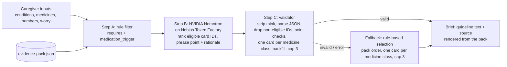

# Navigator by ConditionMap

A caregiver appointment-brief tool for people living with heart failure, type 2 diabetes, and chronic kidney disease (any combination). Caregivers answer three short steps and get up to 3 questions, each with a question to ask the clinician, the guideline text, and a DOI-linked source.

**Live demo:** https://navigateconditionmap.lovable.app

**Try it:** no login needed, and this app does not store what you enter. Pick conditions, add medicines and recent numbers if you have them, and get a brief.

**Educational only. Not medical advice.** Submission for the Nebius x NVIDIA Global AI Hackathon (Best Apps and Agents track).

## Evidence-first pipeline



The model never supplies medical content. Guideline text, sources, and labels are always rendered from the evidence pack.

Class dedupe and backfill (`src/lib/navigator.ts`, shared by the model path and the fallback): the brief keeps at most one card per medicine class, SGLT2 inhibitors (E2, E3, E9, E11) and nonsteroidal MRAs (E6, E10). Other cards in the same class are listed as supporting cards. If the model ranks fewer than 3 usable topics, the remaining slots are filled from eligible cards in pack order, using the card's own guideline text. The fallback runs the same selection on eligible cards in pack order (for heart failure, E9 or E3 first depending on ejection fraction type), so it never needs the model.

## How Nemotron and Nebius Token Factory are used

- Server endpoint: `src/routes/api/public/navigator-brief.ts` (`POST /api/public/navigator-brief`), running server-side on Lovable Cloud hosting. The evidence pack is embedded at `src/server/evidence-pack.ts` (a test checks it matches `src/data/evidence-pack.json`).
- Base URL `https://api.tokenfactory.nebius.com/v1`, OpenAI-compatible `POST /chat/completions`, `temperature 0`, `max_tokens 2400`, 20 s timeout.
- JSON mode: requests set `response_format: {"type": "json_object"}`, and the prompt requires one object of the form `{"points":[{"card_id","point","rationale"}]}`. The validator still strips code fences and `<think>` blocks before parsing, and rejects anything that does not parse.
- Thinking off: for Nemotron models the request sends `chat_template_kwargs: {"enable_thinking": false}`, so the token budget goes to the JSON brief instead of reasoning text.
- Model selection: `NEBIUS_MODEL` if set; otherwise `GET /v1/models`, keep ids containing "nemotron", prefer "super", then "nano", then the first. Cached in memory. The model id and latency are returned and shown in the UI.
- Health check: `POST {"health": true}` returns the selected model and the list of Nemotron model ids (never the key).

## Setup

Prerequisites: [Bun](https://bun.sh) (tested with 1.4.4) and Node 22 or newer (tested with 22.22). The lockfile is `bun.lock`. No other tools or environment variables are needed.

```bash
bun install --frozen-lockfile
bunx vitest run    # tests: pipeline, wording checks, request guards
bun run build      # production build
bun run dev        # local dev server
```

Without a key the app runs end to end using the rule-based fallback and says so on screen.

For live Nemotron answers:

1. Create an API key in the Nebius Token Factory console (https://tokenfactory.nebius.com, API keys).
2. `cp .env.example .env` and set `NEBIUS_API_KEY=...` (optional `NEBIUS_MODEL=`). `.env` is git-ignored. Never commit a key.
3. Restart `bun run dev`. The model id and response time then appear under "How this page was made" on the results page.

On the hosted version the key is set as a secret in the Lovable project settings.

## Repository map

| Path | What it is |
|---|---|
| `src/data/evidence-pack.json` | The 12 guideline cards and their sources (source of truth for all medical text) |
| `src/server/evidence-pack.ts` | Server copy of the same pack (a test checks the two are identical) |
| `src/lib/navigator.ts` | Card filter, model-output validator, wording checks, fallback |
| `src/routes/api/public/navigator-brief.ts` | The server route that calls Nebius Token Factory (key read at line 64, `/chat/completions` call at lines 94 to 103) |
| `src/server/request-guards.ts` | Body size cap and per-IP rate limit |
| `src/routes/index.tsx` | The three-step form, results page, and print layout |
| `scripts/eval` | 30 synthetic cases, the live runner, and the scorer |
| `docs/screenshots` | Screenshots of the app with synthetic example answers |

## Screenshots

All screenshots use synthetic example answers, not a real person. The results page shows real output from the live model.


## Evaluation

`scripts/eval` runs 30 synthetic caregiver cases (no real patient data) against the live endpoint and scores the responses (`bun scripts/eval/score.ts scripts/eval/after.json`). Results, run Oct 29, 2026:

| | Older build (`814a82d`) | Current build (`507bb50`) |
|---|---|---|
| Answered by Nemotron | 27 of 30 | 28 of 30 |
| Fallback | 3 (2 kidney-only cases with no cards, 1 Nebius HTTP 529) | 2 (the same 2 kidney-only cases) |
| Model response time (server-measured) | median 1.9 s, p90 5.4 s, max 12.2 s | median 1.7 s, p90 5.1 s, max 13.8 s |
| Points kept in the model's wording | 64 of 67 (96%) | 52 of 67 (78%) |
| Points replaced with the card's wording | 3 | 15 |
| Violations of 6 structural rules* | 0 | 0 |

*At most 3 points, at most one card per medicine class, only eligible cards, questions verbatim from the card, no milligram dose, no relationship words.

What this does and does not show: the stricter wording checks replace more of the model's sentences with the guideline's own wording (22% versus 4%). The scores cover structure and listed wording rules only. They do not establish clinical correctness. An independent keyword scan of the kept sentences still flagged 7 of 52 that paraphrase a benefit the card states in other words (for example "helps protect the kidneys" for the card on kidney benefit). Thirty synthetic cases from one run on one day is a small sample.

### Running the evaluation yourself

```bash
bun scripts/eval/run.ts https://navigateconditionmap.lovable.app scripts/eval/mine.json
bun scripts/eval/score.ts scripts/eval/mine.json
```

The runner sends 30 live requests paced 62 seconds apart (about 31 minutes; `EVAL_PACE_MS` changes the pace). The endpoint limits each IP address, so do not run other traffic from the same address meanwhile. `baseline.json` is the run on the older build and `after.json` is the run on the current build.

## Known limitations

- Every kidney card requires type 2 diabetes, so kidney disease on its own returns no cards, and kidney disease with heart failure shows heart failure cards only. The app says so on screen.
- Twelve cards from five guideline documents. This is not a complete clinical guideline set, and the cards have not had a clinician review.
- The rate limit and the model-list cache live in one server instance's memory, so they are speed bumps, not hard quotas.

## Project history and what changed during the hackathon

The hackathon submission period began on August 26, 2026. This repository was created on October 28, 2026, and every commit in it is dated October 28 or 29, 2026. An earlier prototype (a Netlify and Tavily version) is in `saebchicago/conditionmap-navigator`, also from October 28. The history here is:

| Date | Commit | Change |
|---|---|---|
| Oct 28 | `2ed2f96` | v1.0: evidence-pack pipeline, Nemotron ranking, validator, fallback |
| Oct 28 | `814a82d` | Evidence wording fixes, request guards, README accuracy |
| Oct 29 | `693a655` | Interface pass: personal results summary, print fixes, new identity |
| Oct 29 | `4be4b12` | Stricter claim checks, steadier output, evaluation scripts |
| Oct 29 | `f85f9d8` | Baseline evaluation results |
| Oct 29 | `18d217d` | Explain the kidney-only gap on screen |
| Oct 29 | `6cfd533` | Honest privacy copy, advice-word checks, input whitelist, print fix |
| Oct 29 | `507bb50` | Trust and visit-day pass: hidden ranking commentary, kidney-only notice, compact print brief |
| Oct 29 | `973eeac` | Post-publish evaluation results |

Parts of the code were written with AI coding assistants (Claude Code and Lovable). The author made the product, content, and safety decisions and reviewed the changes.

## Feedback on Nebius Token Factory and NVIDIA Nemotron

What worked, from building and running this app:

- The OpenAI-compatible API worked with a plain `fetch` call and no SDK.
- JSON mode (`response_format`) returned parseable objects in the evaluation runs, and `chat_template_kwargs.enable_thinking: false` kept replies fast: median 1.7 s and 90th percentile 5.1 s over 28 answered cases.
- `GET /v1/models` made it possible to pick a Nemotron model at runtime instead of hard-coding one.

What would help:

- Model ids use mixed naming (for example `nvidia/nemotron-3-super-120b-a12b` next to `nvidia/Nemotron-3_5-Lightning` and `nvidia/NVIDIA-Nemotron-3-Nano-30B-A3B`), which makes pattern-based selection brittle. Stable aliases would help.
- Clearer documentation of which Nemotron models support JSON mode and the thinking switch.
- One request in the 60 evaluation calls returned HTTP 529 (overloaded). Published guidance on retry behavior and expected capacity would help.

## Evidence sources

- ADA/KDIGO 2022. Diabetes Management in CKD: A Consensus Report. de Boer IH, et al. doi:[10.2337/dci22-0027](https://doi.org/10.2337/dci22-0027)
- ESC 2023 Focused Update of the 2021 HF Guidelines. McDonagh TA, Metra M, et al. doi:[10.1002/ejhf.3024](https://doi.org/10.1002/ejhf.3024)
- AHA/ACC/HFSA 2022 HF Guideline. Heidenreich PA, Bozkurt B, et al. doi:[10.1161/CIR.0000000000001063](https://doi.org/10.1161/CIR.0000000000001063)
- ADA Standards of Care in Diabetes 2026, Section 10: Cardiovascular Disease and Risk Management. ADA Professional Practice Committee. doi:[10.2337/dc26-S010](https://doi.org/10.2337/dc26-S010)
- ADA Standards of Care in Diabetes 2026, Section 11: Chronic Kidney Disease and Risk Management. ADA Professional Practice Committee. doi:[10.2337/dc26-S011](https://doi.org/10.2337/dc26-S011)

### Evidence cards

| Card | Topic | Shown when | Source |
|---|---|---|---|
| E1 | Kidney screening | Type 2 diabetes | ADA/KDIGO 2022 |
| E2 | SGLT2 inhibitor for kidney protection | Type 2 diabetes + CKD | ADA/KDIGO 2022 |
| E3 | SGLT2 inhibitor in heart failure | Heart failure | ESC 2023 |
| E4 | Metformin and kidney function | Type 2 diabetes + CKD, taking metformin | ADA/KDIGO 2022 |
| E5 | ACE inhibitor or ARB with albuminuria | Type 2 diabetes + CKD | ADA/KDIGO 2022 |
| E6 | Finerenone | Type 2 diabetes + CKD | ADA/KDIGO 2022 |
| E7 | GLP-1 receptor agonist | Type 2 diabetes + CKD | ADA Standards 2026, Sec 11 |
| E8 | Blood pressure target | Type 2 diabetes | ADA Standards 2026, Sec 10 |
| E9 | SGLT2 inhibitor in reduced ejection fraction | Heart failure | AHA/ACC/HFSA 2022 |
| E10 | Nonsteroidal MRA in heart failure with ejection fraction above 40% | Heart failure + type 2 diabetes | ADA Standards 2026, Sec 10 |
| E11 | SGLT2 inhibitor to prevent heart failure | Type 2 diabetes + CKD | ESC 2023 |
| E12 | SGLT2 inhibitor and finerenone together | Type 2 diabetes + CKD | ADA Standards 2026, Sec 11 |

## Safety design

- Always-visible emergency banner (call 911).
- Deterministic eligibility filter and validator around the model; model output limited to card IDs and phrasing.
- Prompt forbids new drugs, doses, numbers, or start/stop/change advice. The explanation under each question is a statement; the question itself is always the card's own wording.
- Wording checks in code (`src/lib/navigator.ts`), lexical only: a point that adds a number, medicine or brand name, dose word, safety claim, benefit word, advice or certainty word ("stop", "start", "required", "must", "cure"), reassurance ("not urgent"), or a person reference its card does not support is replaced with the card's own wording. The checks do not verify meaning. Numbers in a generated sentence must come from its card; the caregiver's own results are never restated or judged by the model (the page shows a deterministic note when an eGFR is below a card's named level). The model's per-card ranking explanation is generated but not shown in the interface. Rationales get the same checks and are dropped if they fail.
- Heart failure type is limited to the four UI options, numbers to the five known lab fields, and the endpoint has a body-size cap and a per-IP rate limit.
- Fallback to rule-based selection on any error, clearly labeled.
- No login, and this app stores nothing you enter. It adds no analytics or cookies of its own. Inputs live in the browser tab. Each time a brief is made, they are sent through this app's server to the AI provider (Nebius). The hosting platform (Lovable, behind Cloudflare) may load its own script and set a bot-protection cookie, and fonts load from Google Fonts.

## License

Copyright (C) 2026 Saeb A. Ahsan. Built by Saeb Ahsan.

Licensed under the GNU Affero General Public License v3.0 (AGPL-3.0). See [LICENSE](LICENSE). If you run a modified version as a network service, AGPL-3.0 requires you to offer its users the corresponding source.

Commercial licenses are available for uses that cannot meet AGPL-3.0 terms. Contact via [conditionmap.com](https://conditionmap.com).

## Trademarks

"Navigator" and "ConditionMap" names and logos are not licensed under AGPL-3.0; all rights reserved.
