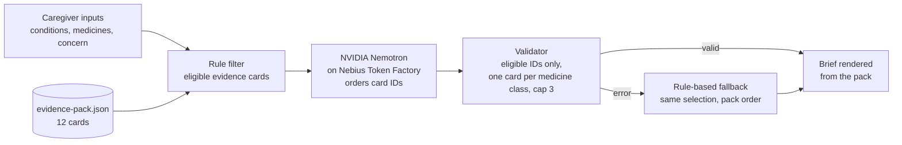
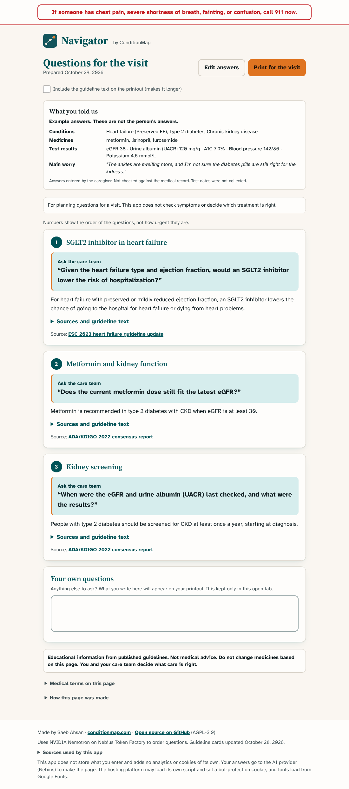

# Navigator by ConditionMap

A caregiver brings a printed brief to the next appointment: up to three questions for the clinician, each with the guideline text behind it and a DOI-linked source. It covers heart failure, type 2 diabetes, and chronic kidney disease, in any combination.

The caregiver can reorder, remove, or add questions (up to five). The printout adds "Before you go" prompts (bring every bottle and the latest results; coverage and cost questions) and an "After the visit" notes page.

**Why:** over 40 million people a day ask ChatGPT health questions, and 7 in 10 of those chats happen outside clinic hours ([OpenAI, Jan 2026](https://cdn.openai.com/pdf/2cb29276-68cd-4ec6-a5f4-c01c5e7a36e9/OpenAI-AI-as-a-Healthcare-Ally-Jan-2026.pdf), self-reported, not independently verified). Navigator gives caregivers questions tied to published guidelines, each with its source. More context: [docs/context.md](docs/context.md).

**Live demo:** https://navigateconditionmap.lovable.app. No login. The app stores nothing you enter.

**Educational only. Not medical advice.** Nebius x NVIDIA Global AI Hackathon, Best Apps and Agents track.

## How it works



- **Nemotron chooses the order. The evidence pack supplies every word.** Each question, explanation, and source shown is the card's own text. The model returns card IDs and a yes/no concern-match flag, so it cannot reword a guideline.
- Why: an audit got the model to write "Combining an ACE inhibitor with an ARB is advised for people with diabetes" using only words from the card, which reverses its meaning. Word checks cannot catch that, so model text is never shown.
- The brief keeps one card per medicine class (SGLT2 inhibitors; nonsteroidal MRAs) and fills empty slots from eligible cards in pack order. The fallback uses the same selection without the model.

## How Nemotron and Nebius Token Factory are used

- **Route:** `POST /api/public/navigator-brief` (`src/routes/api/public/navigator-brief.ts`), server-side, so `NEBIUS_API_KEY` never reaches the browser.
- **API:** `https://api.tokenfactory.nebius.com/v1/chat/completions` (OpenAI-compatible), `temperature 0`, `max_tokens 600`, 20 s timeout.
- **Model:** `NEBIUS_MODEL` if set; otherwise `GET /v1/models`, prefer a Nemotron "super" model, then "nano". Live: `nvidia/nemotron-3-super-120b-a12b`. The model id and latency are shown on the results page.
- **JSON mode:** `response_format: {"type": "json_object"}`; the reply is `{"points":[{"card_id":"E2","matches_concern":false}]}`. Anything else is discarded.
- **Thinking off:** `chat_template_kwargs: {"enable_thinking": false}`, so the token budget goes to the answer.
- **Health check:** `POST {"health": true}` returns the selected model (never the key).

## Results

30 synthetic caregiver cases against the live site, build `9caafa7` (Oct 29, 2026):

- Nemotron answered 28 of 30. The other 2 are kidney-only cases with no eligible cards, so they use the fallback by design.
- Model response time: median 0.9 s, 90th percentile 1.1 s.
- Six structural rules (at most 3 points, one card per class, eligible cards only, verbatim questions, no mg dose, no relationship words): 0 violations.
- Concern-aware ranking, 7 author-chosen cases (re-run Oct 29 after the E7 and E12 wording change): Nemotron put the expected card in the top 3 in 7 of 7; the rule fallback in 3 of 7.

These measure structure and ordering, not clinical correctness, and the sample is small. Full tables, earlier builds, and how to re-run: [docs/evaluation.md](docs/evaluation.md).

## Safety design

- Emergency banner (call 911) on every page. Concerns that mention urgent symptoms, such as chest pain or fainting, add a call-911 notice.
- Eligibility is rule-based. Cards for a different heart failure type are dropped. A medicine line counts as current only if nothing in it says "stopped", "no", or similar; step 2 shows which lines were counted so the caregiver can correct them.
- Test results are never sent to the model. Cards that name an eGFR or potassium level ask the caregiver to bring the latest result instead of comparing numbers.
- Server inputs are whitelisted, bodies over 8 KB are rejected, and each IP is rate-limited (60 requests per 10 minutes).
- Any error falls back to the rule-based brief, labeled as such.
- **Privacy:** the app saves nothing and adds no analytics or cookies of its own. Conditions, medicines, heart failure type, and the concern text go through this app's server to Nebius each time a brief is made. Nebius's legal quick guide says requests may be retained by default unless Zero Data Retention is enabled; that setting is not confirmed for this account. The hosting platform (Lovable, behind Cloudflare) runs its own analytics and cookies, and fonts load from Google Fonts.

## Setup

Requires [Bun](https://bun.sh) (tested 1.4.4) and Node 22+.

```bash
bun install --frozen-lockfile
bunx vitest run    # pipeline, wording checks, request guards
bun run build
bun run dev
```

Without a key the app runs end to end on the rule-based fallback. For live Nemotron: create a key at https://tokenfactory.nebius.com, run `cp .env.example .env`, set `NEBIUS_API_KEY` (optional `NEBIUS_MODEL`), and restart. `.env` is git-ignored. On the hosted app the key is a Lovable project secret.

## Evidence

All medical text lives in `src/data/evidence-pack.json` (server copy in `src/server/evidence-pack.ts`; a test keeps them identical). Wording changes: [docs/evidence-changelog.md](docs/evidence-changelog.md).

- ADA/KDIGO 2022. Diabetes Management in CKD: A Consensus Report. de Boer IH, et al. doi:[10.2337/dci22-0027](https://doi.org/10.2337/dci22-0027)
- ESC 2023 Focused Update of the 2021 HF Guidelines. McDonagh TA, Metra M, et al. doi:[10.1002/ejhf.3024](https://doi.org/10.1002/ejhf.3024)
- AHA/ACC/HFSA 2022 HF Guideline. Heidenreich PA, Bozkurt B, et al. doi:[10.1161/CIR.0000000000001063](https://doi.org/10.1161/CIR.0000000000001063)
- ADA Standards of Care in Diabetes 2026, Section 10: Cardiovascular Disease and Risk Management. ADA Professional Practice Committee. doi:[10.2337/dc26-S010](https://doi.org/10.2337/dc26-S010)
- ADA Standards of Care in Diabetes 2026, Section 11: Chronic Kidney Disease and Risk Management. ADA Professional Practice Committee. doi:[10.2337/dc26-S011](https://doi.org/10.2337/dc26-S011)

| Card | Topic                                                              | Shown when                              | Source                     |
| ---- | ------------------------------------------------------------------ | --------------------------------------- | -------------------------- |
| E1   | Kidney screening                                                   | Type 2 diabetes                         | ADA/KDIGO 2022             |
| E2   | SGLT2 inhibitor for kidney protection                              | Type 2 diabetes + CKD                   | ADA/KDIGO 2022             |
| E3   | SGLT2 inhibitor in heart failure                                   | Heart failure                           | ESC 2023                   |
| E4   | Metformin and kidney function                                      | Type 2 diabetes + CKD, taking metformin | ADA/KDIGO 2022             |
| E5   | ACE inhibitor or ARB with albuminuria                              | Type 2 diabetes + CKD                   | ADA/KDIGO 2022             |
| E6   | Finerenone                                                         | Type 2 diabetes + CKD                   | ADA/KDIGO 2022             |
| E7   | GLP-1 receptor agonist                                             | Type 2 diabetes + CKD                   | ADA Standards 2026, Sec 11 |
| E8   | Blood pressure target                                              | Type 2 diabetes                         | ADA Standards 2026, Sec 10 |
| E9   | SGLT2 inhibitor in reduced ejection fraction                       | Heart failure                           | AHA/ACC/HFSA 2022          |
| E10  | Nonsteroidal MRA in heart failure with ejection fraction above 40% | Heart failure + type 2 diabetes         | ADA Standards 2026, Sec 10 |
| E11  | SGLT2 inhibitor to prevent heart failure                           | Type 2 diabetes + CKD                   | ESC 2023                   |
| E12  | SGLT2 inhibitor and finerenone together                            | Type 2 diabetes + CKD                   | ADA Standards 2026, Sec 11 |

## Known limitations

- Every kidney card requires type 2 diabetes, so kidney disease alone returns no cards, and kidney disease with heart failure shows heart failure cards only. The app says so on screen.
- Twelve cards from five guideline documents, not a complete guideline set, and not yet clinician-reviewed ([review packet](docs/clinical-review-packet.md)).
- The rate limit and model cache live in one server instance's memory, so limits are approximate.

## Built during the hackathon

The submission period began August 26, 2026. This repository was created October 28, 2026, and every commit is dated October 28 to 30. ConditionMap (conditionmap.com) is the author's separate, earlier platform; the Navigator code here is new. Parts were written with AI coding assistants (Claude Code, Lovable); the author made the product, content, and safety decisions and reviewed the changes. Commit-by-commit history: [docs/history.md](docs/history.md).

## Feedback on Nebius Token Factory and NVIDIA Nemotron

- **Worked:** plain `fetch`, no SDK; JSON mode returned parseable objects in the evaluation runs; with thinking off, median model latency was 0.9 s; `GET /v1/models` allowed runtime model choice.
- **Would help:** consistent model ids (`nvidia/nemotron-3-super-120b-a12b` sits beside `nvidia/Nemotron-3_5-Lightning`), clearer docs on which models support JSON mode and the thinking switch, and retry guidance for HTTP 529 (1 of the first 90 evaluation calls).

## Repository map

| Path                                       | Contents                                                                 |
| ------------------------------------------ | ------------------------------------------------------------------------ |
| `src/data/evidence-pack.json`              | The 12 cards and sources, the only source of medical text                |
| `src/lib/navigator.ts`                     | Card filter, model-output validator, fallback                            |
| `src/routes/api/public/navigator-brief.ts` | Server route that calls Nebius Token Factory                             |
| `src/server/request-guards.ts`             | Body size cap, per-IP rate limit                                         |
| `src/routes/index.tsx`                     | Three-step form, results page, print layout                              |
| `scripts/eval`                             | 30 synthetic cases, live runner, scorer                                  |
| `docs/`                                    | Evaluation, history, evidence change log, AI-demand context, screenshots |



## License

Copyright (C) 2026 Saeb A. Ahsan. Licensed under the GNU Affero General Public License v3.0 (AGPL-3.0); see [LICENSE](LICENSE). If you run a modified version as a network service, AGPL-3.0 requires you to offer its users the source. Commercial licenses: contact via [conditionmap.com](https://conditionmap.com).

## Trademarks

"Navigator" and "ConditionMap" names and logos are not licensed under AGPL-3.0; all rights reserved.
